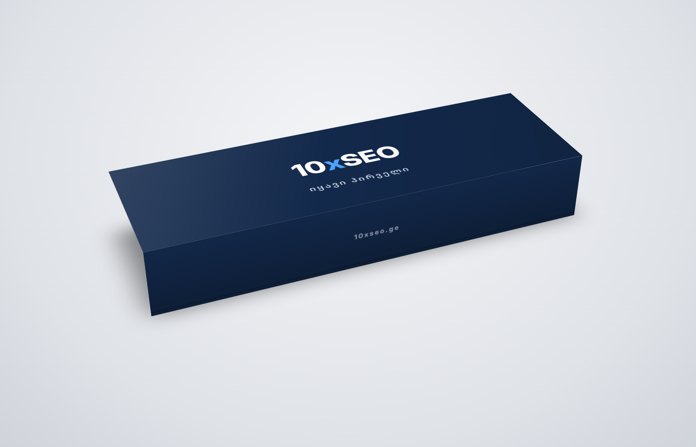

# 10xSEO Welcome Box — ბეჭდვის ფაილები



## ყუთის სპეციფიკაცია (სტამბისთვის)

| პარამეტრი | მნიშვნელობა |
|---|---|
| კონსტრუქცია | მყარი ორნაწილიანი ყუთი (თავსახური + ძირი), როგორც AirPods Max-ის ყუთი |
| თავსახურის გარე ზომა | **243 × 80 × 39 mm** (სიგრძე × სიგანე × სიმაღლე) |
| ძირის გარე ზომა | 238 × 75 × 37 mm (თავსახურში თავისუფლად შედის) |
| მუყაო | 2 mm-იანი მყარი მუყაო (grey board / chipboard 1200 g/m²) |
| გადასაკრავი ქაღალდი | 157 g/m² ცარციანი ქაღალდი, CMYK 4+0 |
| ფერი | მუქი ლურჯი **#13294B** ≈ **Pantone 2767 C** (სპოტ ფერად ბეჭდვა რეკომენდებულია) |
| ლამინაცია | soft-touch მქრქალი ლამინაცია (Apple-ის ყუთის შეგრძნება) |
| ლოგო | თეთრი + მსუბუქი ემბოსი (blind emboss), ან თეთრი ფოლგა |
| „იყავი პირველი“ | ვერცხლისფერი ფოლგა (hot foil silver) |
| 10xseo.ge | წინა გვერდზე, ვერცხლისფერი / spot UV |
| შიგთავსი | შიგნით: თეთრი ან ლურჯი, სურვილისამებრ EVA/მუყაოს ჩასადები |
| turn-in / ბლიდი | 15 mm / 3 mm |

## ფაილები (`out/`)

| ფაილი | რა არის |
|---|---|
| `lid-dieline.pdf` / `.svg` | თავსახურის გადასაკრავი, 1:1 მასშტაბი, ბლიდით (357 × 194 mm) |
| `base-dieline.pdf` / `.svg` | ძირის გადასაკრავი (348 × 185 mm) |
| `lid-dieline-preview.png` | თავსახურის dieline ზომებით (სანახავად) |
| `mockup.png`, `top-view.png` | ვიზუალური მაკეტი |

Dieline-ში: **მაჯენტა ხაზი** = ჭრა, **ცისფერი წყვეტილი** = კეცვა. სტამბამ dieline ცალკე სპოტ-ფენად უნდა გადაიტანოს
და ტექსტი outline-ებად გადააქციოს.

## ⚠️ ლოგო

რეპოზიტორიაში ლოგოს ფაილი არ არის, ამიტომ ახლა **დროებითი ტექსტური ლოგოა** („10xSEO“, `LOGO_PLACEHOLDER`).
გამოგზავნეთ ლოგო SVG/AI ფორმატში და ჩავანაცვლებ `build.py`-ის `logo()` ფუნქციაში.

## ხელახლა აწყობა

```bash
python3 build.py && node render.js
```
