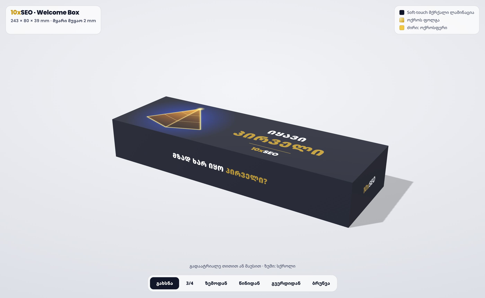
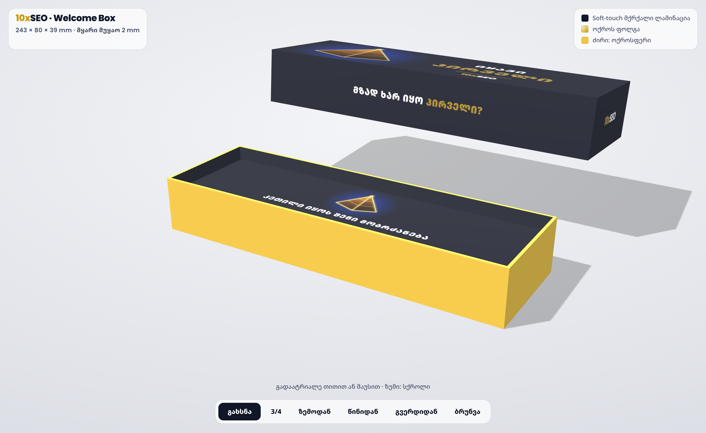

# 10xSEO Welcome Box — ბეჭდვის ფაილები




3D ხედი: `out/box-3d.html` (გახსენით ბრაუზერში).

## ყუთის სპეციფიკაცია (სტამბისთვის)

| პარამეტრი | მნიშვნელობა |
|---|---|
| კონსტრუქცია | მყარი ორნაწილიანი ყუთი (თავსახური + ძირი), როგორც AirPods Max-ის ყუთი |
| თავსახურის გარე ზომა | **243 × 80 × 39 mm** (სიგრძე × სიგანე × სიმაღლე) |
| ძირის გარე ზომა | 238 × 75 × 37 mm (თავსახურში თავისუფლად შედის) |
| მუყაო | 2 mm-იანი მყარი მუყაო (grey board / chipboard 1200 g/m²) |
| გადასაკრავი ქაღალდი | 157 g/m² ცარციანი ქაღალდი, CMYK 4+0 |
| ფერები | ბრენდის მუქი ლურჯი **#111729** (≈ Pantone 5395 C), ოქრო **#F1C744** (≈ Pantone 123 C), ლურჯი ნათება #1E44C8 |
| ლამინაცია | soft-touch მქრქალი ლამინაცია (Apple-ის ყუთის შეგრძნება) |
| სახურავი | პირამიდა ნათებით (CMYK) + „ᲘᲧᲐᲕᲘ ᲞᲘᲠᲕᲔᲚᲘ“ + ლოგო; „ᲞᲘᲠᲕᲔᲚᲘ“ და „10x“ ოქროს ფოლგით |
| წინა გვერდი | „ᲛᲖᲐᲓ ᲮᲐᲠ ᲘᲧᲝ ᲞᲘᲠᲕᲔᲚᲘ?“ |
| უკანა / გვერდები | 10XSEO.GE / ლოგო |
| ძირი | ოქროსფერი (#F1C744): სახურავის ახდისას ჩანს |
| ჩასადები ბარათი | 232 × 69 mm, „ᲙᲔᲗᲘᲚᲘ ᲘᲧᲝᲡ ᲨᲔᲜᲘ ᲛᲝᲑᲠᲫᲐᲜᲔᲑᲐ“ |
| turn-in / ბლიდი | 15 mm / 3 mm |

## ფაილები (`out/`)

| ფაილი | რა არის |
|---|---|
| `lid-dieline.pdf` / `.svg` | თავსახურის გადასაკრავი, 1:1 მასშტაბი, ბლიდით (357 × 194 mm) |
| `base-dieline.pdf` / `.svg` | ძირის გადასაკრავი (348 × 185 mm) |
| `lid-dieline-preview.png` | თავსახურის dieline ზომებით (სანახავად) |
| `insert-card.pdf` | ჩასადები ბარათი |
| `box-3d.html`, `render-*.png` | 3D მაკეტი |

Dieline-ში: **მაჯენტა ხაზი** = ჭრა, **ცისფერი წყვეტილი** = კეცვა. სტამბამ dieline ცალკე სპოტ-ფენად უნდა გადაიტანოს
და ტექსტი outline-ებად გადააქციოს.

## ⚠️ ლოგო

ლოგო აწყობილია Poppins ExtraBold შრიფტით ბრენდის ფაილის მიხედვით. სტამბამდე სჯობს ორიგინალი ვექტორული ლოგო (SVG/AI)
ჩავსვათ `build.py`-ის `logo()` ფუნქციაში. პირამიდაც ვექტორულად არის გადახატული.

## ხელახლა აწყობა

```bash
python3 build.py && node render.js
```
