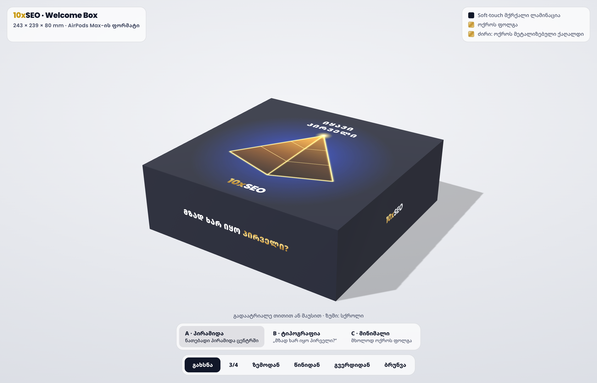
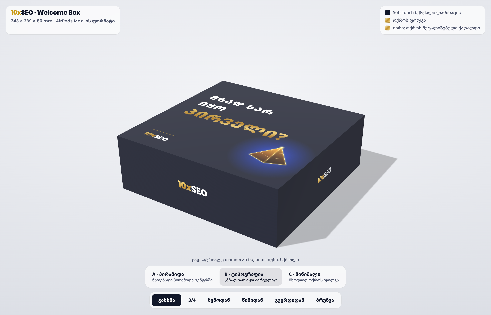
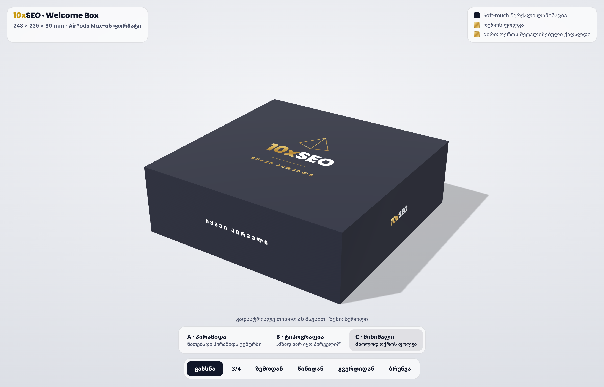

# 10xSEO Welcome Box — ბეჭდვის ფაილები






3D ხედი: `out/box-3d.html` (გახსენით ბრაუზერში).

## ყუთის სპეციფიკაცია (სტამბისთვის)

| პარამეტრი | მნიშვნელობა |
|---|---|
| კონსტრუქცია | მყარი ორნაწილიანი ყუთი (თავსახური + ძირი), როგორც AirPods Max-ის ყუთი |
| თავსახურის გარე ზომა | **243 × 239 × 80 mm**: AirPods Max-ის ყუთის ფორმატი (Amazon: 24.35 × 23.99 × 8.1 cm) |
| ძირის გარე ზომა | 238 × 234 × 78 mm (თავსახურში თავისუფლად შედის) |
| მუყაო | 2 mm-იანი მყარი მუყაო (grey board / chipboard 1200 g/m²) |
| გადასაკრავი ქაღალდი | 157 g/m² ცარციანი ქაღალდი, CMYK 4+0 |
| ფერები | ბრენდის მუქი ლურჯი **#111729** (≈ Pantone 5395 C), ოქრო **#F1C744** (≈ Pantone 123 C), ლურჯი ნათება #1E44C8 |
| ლამინაცია | soft-touch მქრქალი ლამინაცია (Apple-ის ყუთის შეგრძნება) |
| ვარიანტი A: პირამიდა | სახურავზე დიდი ნათებადი პირამიდა, „ᲘᲧᲐᲕᲘ ᲞᲘᲠᲕᲔᲚᲘ“, ლოგო; წინ „ᲛᲖᲐᲓ ᲮᲐᲠ ᲘᲧᲝ ᲞᲘᲠᲕᲔᲚᲘ?“ |
| ვარიანტი B: ტიპოგრაფია | სახურავზე „ᲛᲖᲐᲓ ᲮᲐᲠ ᲘᲧᲝ ᲞᲘᲠᲕᲔᲚᲘ?“ დიდად, პატარა პირამიდა; წინ ლოგო |
| ვარიანტი C: მინიმალი | მხოლოდ ოქროს ფოლგა: ხაზოვანი პირამიდა, ლოგო, „ᲘᲧᲐᲕᲘ ᲞᲘᲠᲕᲔᲚᲘ“; წინ თეთრი ტეგლაინი |
| ფოლგა | ყველა ოქროსფერი ელემენტი: სარკისებრი ოქროს ფოლგა (hot foil gold) |
| უკანა / გვერდები | 10XSEO.GE / ლოგო |
| ძირი | ოქროს მეტალიზებული ქაღალდი (gold metallic paper): სახურავის ახდისას ჩანს |
| ჩასადები ბარათი | 230 × 226 mm, „ᲙᲔᲗᲘᲚᲘ ᲘᲧᲝᲡ ᲨᲔᲜᲘ ᲛᲝᲑᲠᲫᲐᲜᲔᲑᲐ“ |
| turn-in / ბლიდი | 15 mm / 3 mm |

## ფაილები (`out/`)

| ფაილი | რა არის |
|---|---|
| `lid-dieline-a/b/c.pdf` / `.svg` | თავსახურის გადასაკრავი თითო ვარიანტზე, 1:1, ბლიდით (439 × 435 mm) |
| `base-dieline.pdf` / `.svg` | ძირის გადასაკრავი (430 × 426 mm) |
| `lid-dieline-a/b/c-preview.png` | dieline ზომებით (სანახავად) |
| `insert-card.pdf` | ჩასადები ბარათი |
| `box-3d.html`, `render-*.png` | 3D მაკეტი |

Dieline-ში: **მაჯენტა ხაზი** = ჭრა, **ცისფერი წყვეტილი** = კეცვა. სტამბამ dieline ცალკე სპოტ-ფენად უნდა გადაიტანოს
და ტექსტი outline-ებად გადააქციოს.

## ⚠️ ლოგო

ლოგო აწყობილია Poppins ExtraBold შრიფტით ბრენდის ფაილის მიხედვით. სტამბამდე სჯობს ორიგინალი ვექტორული ლოგო (SVG/AI)
ჩავსვათ `build.py`-ის `logo()` ფუნქციაში. პირამიდაც ვექტორულად არის გადახატული.

## ხელახლა აწყობა

```bash
python3 build.py && node render.js
```
